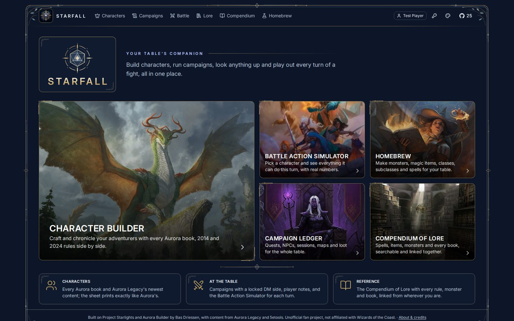
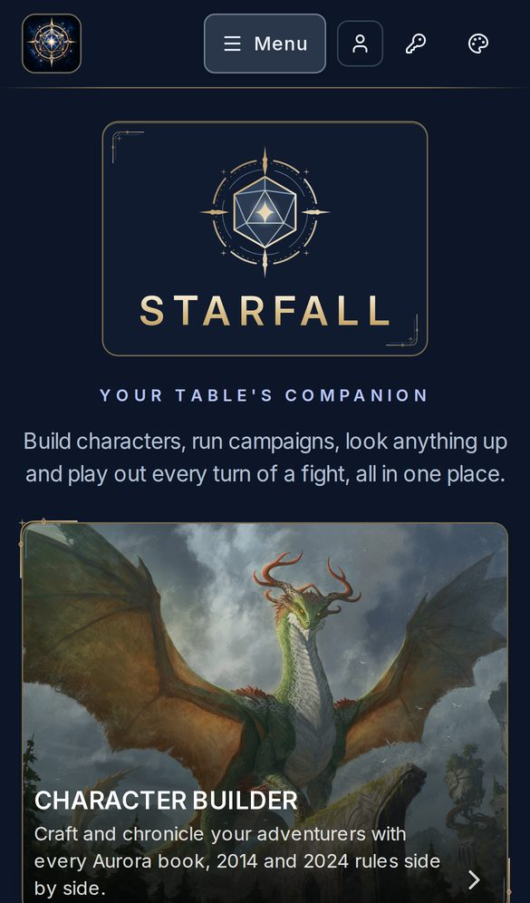
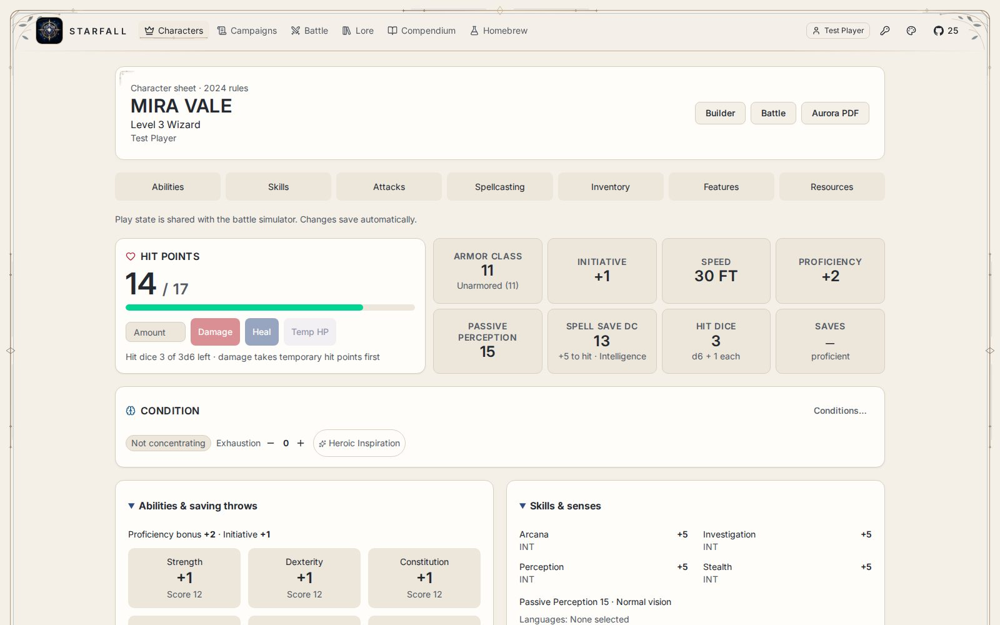
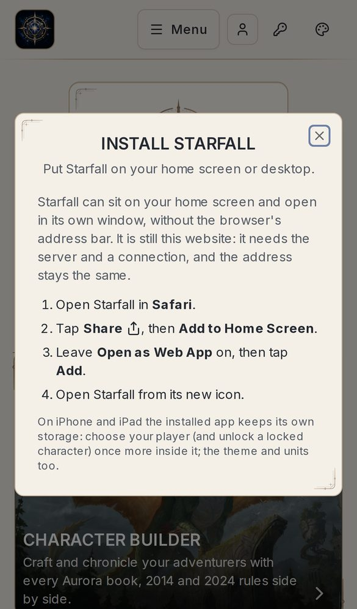

# Starfall

**Your table's companion for Dungeons & Dragons 5e**: characters, campaigns, battles, rules lookup and homebrew, in the
browser, on a computer you own. Free and open source (MIT), with no accounts, subscriptions or tracking, and no AI.

Latest release: **v0.11.1** ([release](https://github.com/CHassapis/Starfall/releases/tag/v0.11.1) ·
[release notes](docs/releases/v0.11.1.md); earlier: [v0.11.0](docs/releases/v0.11.0.md),
[v0.10.0 public beta](docs/releases/v0.10.0.md)).

**Contents:** [What it is](#what-starfall-is) · [Screenshots](#screenshots) · [Requirements](#requirements) ·
[Quick install](#quick-install) · [First run](#first-run) · [iPhone and iPad](#install-on-iphone-and-ipad) ·
[Android](#install-on-android-and-computers) · [HTTPS](#https) · [Updating](#updating) ·
[Backups](#backups-and-restoring) · [Troubleshooting](#troubleshooting) · [Developers](#developer-documentation) ·
[Licence and credits](#licence-and-attribution)

## What Starfall is

Starfall is a self-hosted fork of **Project Starlights** by **Bas Driessen**, the creator of
[Aurora Builder](https://www.aurorabuilder.com) ([swdriessen/starlights](https://github.com/swdriessen/starlights)),
packaged by C Hassapis to run in Docker for a D&D group. One computer at home runs it; everyone at the table uses it
from a browser on their phone, tablet or laptop, and can put it on their home screen like an app. It brings in its own
rules content from [Aurora Legacy](https://github.com/AuroraLegacy/elements) and
[5etools](https://github.com/5etools-mirror-3/5etools-src): no book content is part of this repository.

- **Character builder**: 2014 and 2024 rules (or both), multiclassing, a step-by-step wizard for new players, every
  Aurora Legacy book; each option says what it needs. Bring in players' Aurora `.dnd5e` characters.
- **Character sheets like Aurora's**, on screen and as PDF, built in; an interactive play sheet shares hit points,
  conditions, rests, equipment and spells with Battle. Custom attacks, portraits, and character files you can move
  between Starfall servers ([character portability](docs/character-portability.md)).
- **Battle Action Simulator**: everything a character can do this turn, with real numbers: attacks, spells and
  slots, magic items with charges, familiars, conditions.
- **Campaigns** with a locked DM side: sessions, NPCs, places, quests, maps, handouts, a party fund and stash, magic
  items handed out, and **encounters run as fights** (initiative, hidden monster hit points, the party's live state,
  2014 and 2024 difficulty). Players see only what the DM reveals.
- **Compendium of Lore**: books, spells, items and creatures, searchable and linkable from campaigns.
- **Homebrew**: magic items, monsters, spells, subclasses and classes from forms, or Aurora element files; off until a
  player or DM switches it on.
- **Made for the table**: Porcelain, Slate and Midnight themes, phone to 4K layouts, Imperial or Metric units for
  display, and an install option for phones and computers.

The full guide for players and DMs (exporting a campaign, homebrew files, settings, how content is connected) is
**[docs/using-starfall.md](docs/using-starfall.md)**.

## Screenshots

<p align="center">
  
  &nbsp;
  
</p>
<p align="center">
  
  &nbsp;
  
</p>
<p align="center"><sub>The home page (Midnight), a character's play sheet (Porcelain) and Install Starfall on an
iPhone. Made with synthetic test data.</sub></p>

## Requirements

- **A computer that stays on while you play**: a home server, a spare PC or a NAS that runs Docker.
  - **64-bit Intel/AMD (x86-64) only.** The database (Microsoft SQL Server) has no ARM version: no Raspberry Pi, no
    Windows on ARM.
  - **4 GB of RAM** for Docker (8 GB recommended) and **at least 10 GB free disk** (20 GB recommended).
- **Linux** (Ubuntu or Debian) with Docker Engine and its Compose plugin, or **Windows** with WSL2 and Docker Desktop.
  `git`, `python3` and `curl` in Linux/WSL. Your user must be able to run `docker info` without sudo.
- An internet connection for the first setup (the Docker images and about 200 MB of content).
- For players: any current browser. Installing it as an app needs the site's **https** address (see [HTTPS](#https)).

The Docker build supplies Node.js and .NET; they are not needed on the host. Validation status: Linux installs,
repeat setup, backups, restores, updates and rollbacks are tested on Ubuntu with real Docker; **Windows (Docker
Desktop, WSL2) is implemented but not yet tested on real Windows hardware**. Details:
[docs/installation.md](docs/installation.md).

## Quick install

The full, step-by-step guide (including Windows) is **[docs/installation.md](docs/installation.md)**.

**Linux** (and Windows, in the Ubuntu terminal of WSL2):

```bash
cd ~
git clone --branch aurora-server https://github.com/CHassapis/Starfall.git starfall
cd starfall/deploy
./setup.sh --check     # checks Docker, memory, disk and the port; changes nothing
./setup.sh
```

On Windows, install WSL2 with Ubuntu and Docker Desktop (WSL2 backend, Linux containers, WSL integration for Ubuntu on),
and keep the checkout in your Linux home (`~/starfall`), never on `C:\` or `/mnt/c`. A PowerShell launcher
(`deploy/setup.ps1`) does the same from PowerShell; see
[installation.md](docs/installation.md#windows-docker-desktop-and-wsl2).

What setup does: it checks the prerequisites, writes `deploy/.env` once with random passwords (never printed), builds
and starts the database, API and web app, and has the app download and import Aurora Legacy and the 5etools data
(20–40 minutes the first time). Running `./setup.sh` again is safe: it never replaces `.env` and never deletes anything
in `data/`, including your backups. The port is busy? `./setup.sh --port 8094` on a new install. On a slow machine,
allow more time: `STARLIGHTS_SETUP_BUILD_TIMEOUT=3600 STARLIGHTS_SETUP_CONTENT_TIMEOUT=3600 ./setup.sh`.

## First run

1. **Open Starfall**: `http://localhost:8093` on that computer, or `http://<its LAN address>:8093` from phones and
   other computers at home (`hostname -I` on Linux, `ipconfig` on Windows, or your router's device list). The site
   restarts by itself after a reboot (on Windows, while Docker Desktop runs). Don't forward the port on your router:
   for play away from home see [HTTPS](#https).
2. **Unlock the DM side**: your admin password is `STARLIGHTS_MASTER_PASSWORD` in `deploy/.env` (open it privately in
   an editor; setup never prints it). Enter it with the **key button** in the header. It opens every character and
   campaign, and the **Content** page, which shows the content import's progress and the server's version.
3. **Each player picks their name** (top right) and can lock it with a password. There are no accounts.
4. **Create Character** once the content import has finished; "Guide me step by step" walks a new player through.
   Press **Save** to keep changes.
5. **Pick a theme and units** with the palette button: Porcelain, Slate or Midnight, Imperial or Metric.
6. **Make your first backup** from the `deploy/` folder: `maintenance/backup.sh` (see
   [Backups](#backups-and-restoring)).

More for players and DMs (campaigns, encounters, homebrew, exporting): [docs/using-starfall.md](docs/using-starfall.md).

## Install on iPhone and iPad

Starfall can sit on the home screen and open full screen, without Safari's address bar. It is still your server's
website: it needs the server and a connection, and nothing is stored for offline use. It needs the site's
**https://** address ([HTTPS](#https)); on a plain `http://` address Safari can only add a bookmark.

1. Open Starfall's https address in **Safari**.
2. Tap **Share** (the square with an arrow), then **Add to Home Screen**.
3. Leave **Open as Web App** on (older iOS versions have no switch), then tap **Add**.
4. Open Starfall from its new icon.

The same steps are in Starfall itself: **Menu → Install Starfall** on a phone, or the palette button's **Install
Starfall as an app**. On iPhone and iPad the home-screen app keeps **its own storage**: choose your player (and unlock
a locked character) once more inside it, and the theme and units too.

## Install on Android and computers

With the site's **https://** address ([HTTPS](#https)):

- **Android (Chrome)**: open Starfall, then **Menu → Install Starfall → Install Starfall** in the app, which shows
  Chrome's own install prompt; or Chrome's menu **⋮ → Install app** (on some versions **Add to home screen →
  Install**). Choose install, not "Create shortcut": a shortcut opens a normal browser tab.
- **Computers (Chrome or Edge)**: the install button at the end of the address bar, or the palette button's **Install
  Starfall as an app**. Firefox and Safari on a computer don't install sites; use Starfall in a tab.

Starfall never pops up an install banner by itself; it is offered only from those menus, and hidden once you are in
the installed app. Updates arrive with the server's: close and reopen the app after an update.

## HTTPS

At home, `http://<server>:8093` is fine in a browser. HTTPS is needed to **install** Starfall on a phone or computer,
and to use it **away from home**. The site must stay private: it serves book content for your table's own use, and
players have names, not accounts. **Never forward the port on your router** or publish it on the open internet.

**Recommended: Tailscale Serve.** [Tailscale](https://tailscale.com) (free for personal use) puts your devices on a
private network and gives the server an https address with a real certificate, reachable only from your devices:

1. Install Tailscale on the server and on each player's device, signed in to the same tailnet (or share the server
   with players' accounts).
2. In the Tailscale admin console, under **DNS**, turn on **MagicDNS** and **HTTPS Certificates**.
3. On the server:

   ```bash
   sudo tailscale serve --bg 8093           # https://<server-name>.<your-tailnet>.ts.net → Starfall
   tailscale serve status                   # shows the address
   ```

   (Use your `STARLIGHTS_PORT` if it isn't 8093; `sudo tailscale serve --https=443 off` stops it.) The first visit
   can take a few seconds while the certificate is issued. The machine's name appears in public certificate logs.
4. Everyone opens `https://<server-name>.<your-tailnet>.ts.net`, and can install it from there.

Don't use Tailscale **Funnel**, or anything else that puts Starfall on the open internet: an install made by
`setup.sh` has no site-wide password. (The project's own server publishes one only behind a site password, on a
separate door of the web container; that is not part of this setup.)

**Your own reverse proxy** (Caddy, nginx, Traefik) also works, if its certificate is one your devices trust (a domain
you own with a certificate from Let's Encrypt through a DNS challenge works without opening any port). Send
everything to `http://127.0.0.1:8093`, allow uploads of at least **8 MB** (portraits, homebrew, campaign files) and
responses up to **10 minutes** (a full content import runs in one request), and keep it on your private network.
Self-signed certificates make phones refuse to install.

## Updating

From the `deploy/` folder:

```bash
maintenance/update.sh --check     # what the update brings and whether it changes the database; changes nothing
maintenance/update.sh             # asks, backs up, keeps the running version for a rollback, then updates
```

It refuses to run with local code changes or anything but a straight fast-forward, makes a verified backup first,
builds the new version while the old one keeps running, and afterwards checks that the site works and that no
characters, campaigns, players, portraits or homebrew went missing. If something goes wrong it says exactly how to go
back: `maintenance/rollback.sh <old version>` (program only) or, when the update changed the database, a restore of
the backup it made. Details: [docs/maintenance.md](docs/maintenance.md#updating-to-a-new-version). Don't update with a
bare `git pull` + `docker compose build`: that has no backup and no way back once the database has changed.

Release notes say when content must be imported again. Coming from a version before October 2026, do it once, while
nobody is using the site: `./admin.sh import AuroraLegacy.index --replace`, then `./admin.sh import homebrew --replace`
if you have homebrew, then `./admin.sh import 5etools --replace`, `./admin.sh import starlights --replace` and
`./admin.sh reprocess`. Characters keep their picks. New content (not code): the Content page's **Save and update
now**, or `./admin.sh update` ([more](docs/using-starfall.md#content-from-the-command-line)).

**From Project Starlights' names.** Starfall is the same project under a new name: existing installs need no database
migration or folder rename. Keep the `STARLIGHTS_*` settings, Docker project and volume names, storage keys and
`.starlights.json` character files; API routes and internal names are unchanged. For an existing clone, update only
your fork remote (`git remote set-url mine https://github.com/CHassapis/Starfall.git`, using your remote's name), never
an `origin` that points to Bas Driessen's upstream. The default branch stays `aurora-server`.

## Backups and restoring

Your group's data is the database (characters, campaigns, players, imported content and homebrew) and the portraits,
campaign pictures, homebrew files and artwork in `deploy/data`. The downloaded books can always be downloaded again.
From the `deploy/` folder, while the site runs:

```bash
maintenance/backup.sh                      # SQL Server's own backup (checked by SQL Server) + the folders
maintenance/verify.sh --deep               # proof the newest backup restores (in a throwaway database, not your site)
maintenance/restore.sh data/backups/<folder>
```

A backup is a folder in `deploy/data/backups/` that only your user can read: the database backup, the folders, a
manifest of what is in it and checksums. **Copy it to another disk or computer** too. Don't back up by copying
`data/mssql`: SQL Server's files copied while it runs can be broken without anyone noticing.

`restore.sh` replaces what is there now, so it checks the backup fully first, refuses one made by a newer version,
asks you to type the install's name, makes a safety backup of the current state, and moves the current folders aside
instead of deleting them. Moving to a new computer: install there with `setup.sh`, copy the backup folder into its
`deploy/data/backups/`, restore. Nightly backups and what each message means: [docs/maintenance.md](docs/maintenance.md).
These scripts are for installs made from `deploy/` by `setup.sh`; a server set up some other way needs its own backup
routine.

**Stopping Starfall** without losing anything: `docker compose down` in `deploy/` stops and removes the containers;
your data stays in `deploy/data` and `docker compose up -d` brings it back. To remove Starfall for good, first copy
the backups you want to keep somewhere else, then delete the checkout yourself.

## Troubleshooting

| Problem | What to do |
|---|---|
| `setup.sh` stops with an error | It names the step and what to do; rerunning it is safe. Exit code 2 means the app runs but content is incomplete. More in [installation.md](docs/installation.md#timeouts-and-troubleshooting). |
| A backup, restore or update stops | It says why and what to do; nothing was half-done without saying so. See [maintenance.md](docs/maintenance.md#when-something-goes-wrong). |
| "port is already allocated" | Another program uses 8093: on a new install `./setup.sh --port 8094`; on an existing one set `STARLIGHTS_PORT` in `.env` and run `docker compose up -d`. |
| Phones can't open `http://<server>:8093` | Use the server's LAN address, not `localhost` or the WSL address; the host firewall must allow the port on your private network. |
| The Compendium of Lore says it isn't set up | On the Content page press **Download everything again** (or `./admin.sh update --force`). |
| The content update stopped | The Content page shows the step and the reason. "GitHub did not answer" usually means its limit of 60 checks an hour: try again later. |
| New classes or options don't show after an update | `./admin.sh reprocess` |
| No way to install Starfall on a phone | Use the **https://** address ([HTTPS](#https)), in Safari on iPhone/iPad or Chrome on Android. On `http://` the Install Starfall dialog says so. |
| The installed app asks for my player again (iPhone/iPad) | Expected: the home-screen app has its own storage. Pick your player once inside it. |
| The installed app shows the old version after an update | Close it fully and open it again (nothing is kept offline, so a fresh start loads the new version). |
| A player forgot their password | Unlock admin with the key button, pick that player's name (top right), and use **Change password** to set a new one or remove it. |
| You forgot the admin password | It's `STARLIGHTS_MASTER_PASSWORD` in `deploy/.env`. |
| Something else | `docker compose ps` shows what is running; `docker compose logs --tail=100 starlights-api` shows recent API logs. Logs can hold private content: don't paste them, or `.env`, into public bug reports. |

## Developer documentation

Starfall is a .NET modular monolith (API, EF Core, SQL Server) with a React + Vite web app.

- **Architecture and working notes**: [docs/ai/ARCHITECTURE.md](docs/ai/ARCHITECTURE.md),
  [FRONTEND_GUIDE.md](docs/ai/FRONTEND_GUIDE.md) (themes, ornament, units, PWA, large screens),
  [DECISIONS.md](docs/ai/DECISIONS.md), [CI.md](docs/ai/CI.md) and the
  [project status](docs/ai/PROJECT_STATUS.md).
- **HTTP API** for other programs: [docs/api/README.md](docs/api/README.md) (players and `X-Player-Token`,
  characters, attacks, inventory, magic and combat), the OpenAPI 3.1 description [docs/api/openapi.json](docs/api/openapi.json)
  (checked against the endpoints by a test), viewable with [docs/api/index.html](docs/api/index.html), and
  [Python](docs/api/examples/starlights_client.py) and [TypeScript](docs/api/examples/starlights-client.ts) examples.
  Keep the server on your private network.
- **Installer and maintenance tools**: `deploy/` ([installation.md](docs/installation.md#validation-and-maintenance-handoff),
  [maintenance.md](docs/maintenance.md)).

### Running locally

Needs the .NET 10 SDK, Node.js 22.19+ (or a supported Node.js 24) and Docker. The project uses .NET Aspire: open
`Starlights.slnx` in Visual Studio with `Starlights.AppHost` as the startup project (`https` profile) and press F5, or
run `aspire run` ([aspire.dev](https://aspire.dev)) in the repository root. It starts SQL Server in a container, applies
the migrations, and runs the API, the web app and the Aspire dashboard; run the API's **Initialize Database** action
in the dashboard once.

### Tests

```bash
dotnet test                                                # backend, from the repository root
python3 -m unittest discover -s deploy/installer-tests -v  # installer contract tests
cd src/frontend && npm ci && npm run build && npm run test -w apps/builder-app && npm run lint
```

Set `LORE_SRC` to a complete local 5etools source checkout to include the real-content tests. The browser checks in
`tools/frontend/` (`smoke`, `accessibility`, `homepage-branding`, `ornaments`, `units`, `pwa`, …) run with Playwright
against a local build started with `VITE_API_BASE=''` and answer every API request from a synthetic fixture; see
[FRONTEND_GUIDE.md](docs/ai/FRONTEND_GUIDE.md). Keep test databases, content and browser fixtures away from a real
install, and never run deployment scripts as tests.

### Known limitations

- Windows/WSL2 installs and exhaustive class, content and accessibility coverage are not certified. Installing as an
  app was checked with browser emulation of iPhone and Android, not on physical devices.
- Homebrew saving needs a completed initial content import. Custom classes do not implement Mystic Arcanum,
  third-casters or custom resource pools. Simultaneous builder/Battle edits can leave charge displays stale.
- Custom attack figures stay as written; they are not recalculated on level-up. The API exposes the ingredients for
  weapon attacks, not finished attack totals.
- Campaign exports are readable archives; campaign import is not implemented. Character imports require matching
  books and homebrew. Units convert numbers and short rule labels, not rules prose or free text.
- There is no offline mode: the installed app needs the server.
- `npm audit` lists advisories in development tooling and react-router's server mode, which the released static web
  app does not run; the server's NuGet audit lists a transitive `System.Security.Cryptography.Pkcs` to update.
  The v0.10.0 [verification report](docs/ai/V0_10_0_VERIFICATION.md) has the full evidence.

## Licence and attribution

- **Software**: MIT licence, [LICENSE](./LICENSE) (© 2025 Bas Driessen). [Project Starlights](https://github.com/swdriessen/starlights)
  and [Aurora Builder](https://www.aurorabuilder.com) by **Bas Driessen**: the app, its rules engine and the Aurora way
  of building characters. This fork (Docker packaging, and the features above) by C Hassapis.
- **Content**: [Aurora Legacy](https://github.com/AuroraLegacy/elements) (the community's content files) and
  [5etools](https://github.com/5etools-mirror-3/5etools-src) (the data behind the Compendium of Lore), downloaded by
  your own server for your own table's use. **No book content is in this repository.**
- **PDF sheet**: Aurora Builder's sheet templates (their artwork and the Dungeons & Dragons logos belong to their
  owners) and the fonts [Carlito](https://github.com/googlefonts/carlito) and Adobe's
  [Source Sans 3](https://github.com/adobe-fonts/source-sans) (SIL Open Font License); see
  [the sheet's folder](./src/frontend/apps/builder-app/src/assets/sheet/README.md).
- **Branding**: the Starfall emblem, icons and celestial ornament are the project's own
  ([branding notes](src/frontend/apps/builder-app/public/branding/README.md)).
- **Artwork**: the MIT licence does not establish redistribution rights for third-party artwork or sheet logos. No
  grant is on record for the bundled background pictures or the sheet templates' D&D logos; the owner chose to publish
  them as they are. A group can use its own pictures instead ([how](docs/using-starfall.md#how-aurora-legacy-and-5etools-are-connected)).

Dungeons & Dragons and its books belong to Wizards of the Coast. Starfall is an unofficial fan project, not approved
or endorsed by Wizards of the Coast.

<details>
<summary>The original Project Starlights README (Bas Driessen)</summary>

This is a work-in-progress project intended as an online toolset to enhance tabletop role‑playing games. Its initial
focus is creating characters for Dungeons & Dragons in the form of an online version of
[Aurora](https://www.aurorabuilder.com), which was my original creation years ago.

If you'd like to see this project grow, please consider giving it a star :star: — thank you!

There is no public-facing website hosted for this project at this time, and more details will be shared as
development progresses.

_A screenshot from the experimental Development UI in this project._


The project follows a **Modular Monolith** architecture, organized by business capability: the **Elements Module**
(game data: classes, abilities, features, rules), the **Characters Module** (character creation and management) and
the **Platform Layer** (hosting, logging, data, eventing). Each module is self-contained with its own domain logic,
data persistence, and API endpoints.

This project builds on my experience developing [Aurora](https://www.aurorabuilder.com), a character builder for
Windows. It is developed in the open under the [MIT License](./LICENSE).

</details>
